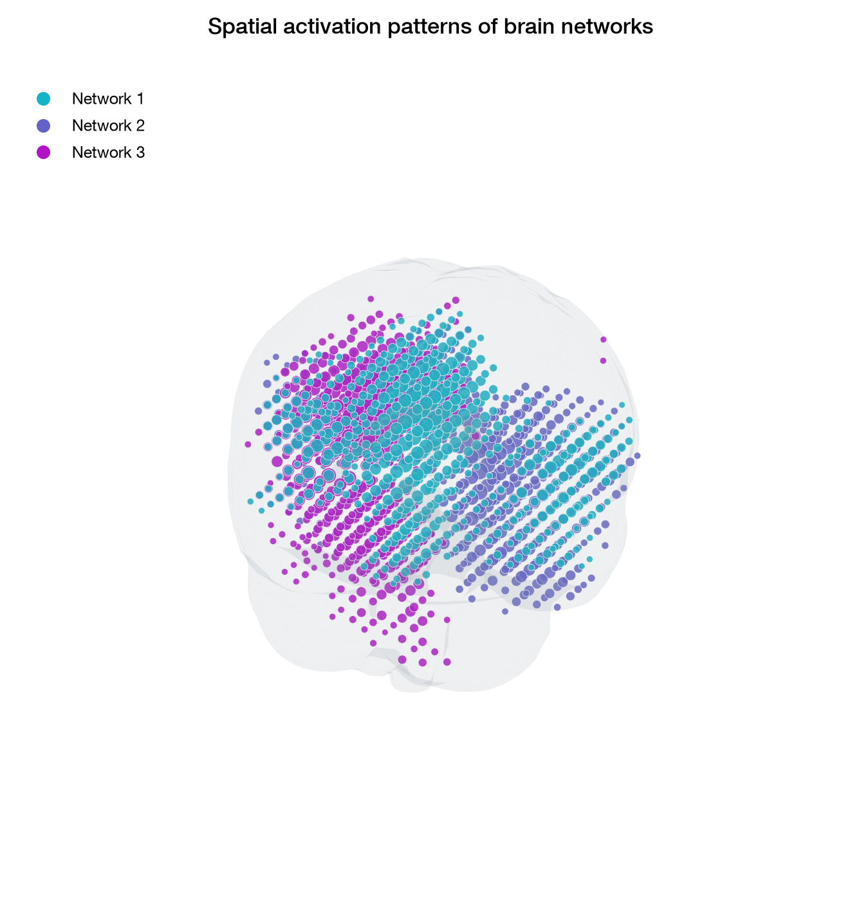

# BROADNESS for Python

This directory contains the modular Python implementation of the BROADNESS
toolbox. The MATLAB implementation is in the sibling `matlab` directory.

Each public MATLAB function will have one corresponding Python module and
function. There will be no all-in-one pipeline: users will call only the
individual BROADNESS functions required for their analysis.

## Environment setup

Use Python 3.11 or newer. From this directory, create and activate a virtual
environment, then install the package:

```text
python -m venv .venv
source .venv/bin/activate
python -m pip install -e .
```

On Windows, activate with `.venv\Scripts\activate` instead. For figures and
NIfTI/Excel export, install `python -m pip install -e ".[visualize]"`.

Conda is also supported:

```text
conda env create --file environment.yml
conda activate broadness
```

Run the tests with:

```text
python -m pip install -e ".[test]"
python -m pytest
```

See [porting status](docs/PORTING_STATUS.md) for the current coverage of the
newer MATLAB toolbox. The package is still an incomplete port.

## Indexing convention

Public arguments that select components or participants use one-based numbers
for consistency with the MATLAB toolbox, scientific figures, and publications.
Direct NumPy array indexing follows the standard Python zero-based convention.

## Spatial-pattern visualization

The three-dimensional spatial-pattern plot places the original source-level
network activations inside a smooth 1-mm MNI152 brain surface. The anatomical
surface improves visual context without interpolating or changing the spatial
resolution of the estimated networks.



## Data policy

Participant data and generated analysis outputs must remain local and must
never be committed to the repository. The package contains compact anatomical
reference assets: a 92-KB surface mesh derived from the 1-mm MNI152 brain
template, plus the small 8-mm templates and coordinate files used for spatial
visualization. None contains participant or experimental data.

The existing `BROADNESS_Startup` helper can locate MATLAB resources when
working from this repository. Python functions can be imported after package
installation without calling it.
