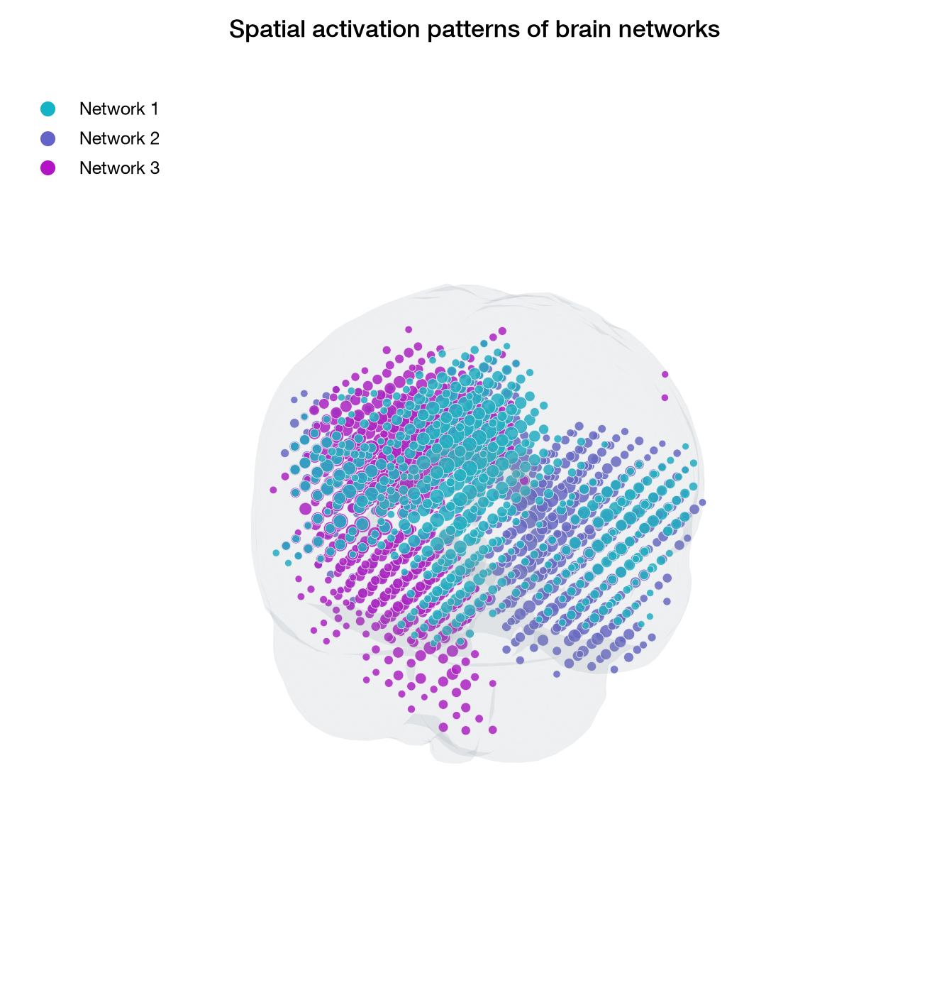

# BROADNESS Python function guide

This directory contains the modular Python implementation of the BROADNESS
toolbox. The MATLAB implementation is in the sibling `matlab` directory.

**New to Python?** Start with [BROADNESS in VS Code: first steps](VS_CODE_FIRST_STEPS.md).
It walks through installation, the first `# %%` example, and the Variables
explorer using a small generated dataset. The example is
[`examples/00_vscode_quickstart.py`](../examples/00_vscode_quickstart.py).

Each public MATLAB function has one corresponding Python module and
function. There is no all-in-one pipeline: users call only the
individual BROADNESS functions required for their analysis.

PCA and ICA are available with the same input axis order as MATLAB:

```python
from broadness import (
    BROADNESS_NetworkEstimation,
    BROADNESS_AlternativeNetworkEstimation_ICA,
)

pca = BROADNESS_NetworkEstimation(data, time, components_num=30)
ica = BROADNESS_AlternativeNetworkEstimation_ICA(data, time, icacomps=10)
```

`data` has shape sources × time × [conditions] × [participants]. The PCA
result includes group patterns, network time series, and participant-specific
spatial patterns when participant data are provided. ICA uses the JADE method
from MATLAB's `jadeR.m`; it can choose a component count automatically from
`total_varexp` when `icacomps` is omitted.

The temporal statistics functions accept the network time series returned by
PCA. For example:

```python
from broadness import BROADNESS_TemporalClusterCorrection

significant, cluster_p, alpha, details = BROADNESS_TemporalClusterCorrection(
    pca.TimeSeries_BrainNetworks[:, :2, :, :],
    condition_pairs=[[1, 2]],
    time=pca.Time,
)
```

`cluster_p` contains **cluster-level** corrected p-values repeated over each
cluster, with NaN elsewhere; it is not a map of pointwise adjusted p-values.
The group procedures use an approximate wild bootstrap. Their default is 5,000
resamples, so use small values only for exploratory runs and software checks.

Phase-space and spatial numerical analysis is also available. For example,
after estimating networks:

```python
from broadness import BROADNESS_PhaseSpace_RQA, BROADNESS_PhaseSpaceStatistics

rqa, rqa_figures = BROADNESS_PhaseSpace_RQA(
    pca, principalcomps=(1, 2), threshold=0.1, theiler_window=1
)
phase_stats = BROADNESS_PhaseSpaceStatistics(rqa)

print(rqa.RQA_metrics[0])             # participant 1; one row per condition
print(phase_stats.Metrics.Speed.shape) # time × conditions × participants
```

The spatial functions are `BROADNESS_SpatialActivationClustering`,
`BROADNESS_SpatialPatternStatistics`, and
`BROADNESS_SpatialPatternGroupStatistics`. Spatial inference needs individual
maps from a common decomposition. Permutation/bootstrap defaults are 1,000;
small counts are suitable only for software checks. Clustering uses a limited
number of k-means restarts and silhouette sample by default to control cost.
RQA recurrence matrices scale quadratically with the number of time samples.
Figure generation is optional. Use `figuremode="save"` with an `OutputPath` to
write figures, or keep the default `figuremode="off"` for numerical analysis.
For example:

```python
from broadness import BROADNESS_Plot_ActivationTimeseries

figures = BROADNESS_Plot_ActivationTimeseries(
    pca.TimeSeries_BrainNetworks,
    pca.Time,
    FigureMode="save",
    FigureLayout="both",
    OutputPath="./Output",
)
print(figures.Files)
```

Figure modes are `off`, `show`, `save`, and `both`; layouts are `individual`,
`summary`, and `both`. PNG and PDF exports work across the figure functions.
The `fig` option saves a Python Matplotlib pickle for local editing; it cannot
be opened as a MATLAB `.fig` file. Open only trusted pickle files. The
visualizer also accepts these figure options in its `Options` dictionary.
The spatial figures use two fixed brain views in the VS Code Interactive
Window and in saved PNG/PDF files. This avoids a large, slow 3D widget.

## Environment setup

Use Python 3.11 through 3.14. From the parent `python/` directory, create and activate a virtual
environment, then install the package:

```text
python -m venv .venv
source .venv/bin/activate
python -m pip install -e .
```

On Windows, activate with `.venv\Scripts\activate` instead. For figures and
NIfTI/Excel export, install `python -m pip install -e ".[visualize]"`.

Conda is also supported:

```text
conda env create --file environment.yml
conda activate broadness
```

Run the tests with:

```text
python -m pip install -e ".[test]"
python -m pytest
```

See [porting status](PORTING_STATUS.md) for the current coverage of the
newer MATLAB toolbox. The three real-data examples are linked from the
[main Python README](../README.md). Direct MATLAB numerical comparisons remain
pending.

## Indexing convention

Public arguments that select components or participants use one-based numbers
for consistency with the MATLAB toolbox, scientific figures, and publications.
Direct NumPy array indexing follows the standard Python zero-based convention.

## Spatial-pattern visualization

The three-dimensional spatial-pattern plot places the original source-level
network activations inside a smooth 1-mm MNI152 brain surface. The anatomical
surface improves visual context without interpolating or changing the spatial
resolution of the estimated networks.



## Data policy

The [VS Code first-steps guide](VS_CODE_FIRST_STEPS.md#6-download-real-example-data-optional)
shows where to download the published data and exactly where to place the
averaged and participant `.mat` files. The small quickstart needs no data
download.

Participant data and generated analysis outputs must remain local and must
never be committed to the repository. The package contains compact anatomical
reference assets: a 92-KB surface mesh derived from the 1-mm MNI152 brain
template, plus the small 8-mm templates and coordinate files used for spatial
visualization. None contains participant or experimental data.

The existing `BROADNESS_Startup` helper can locate MATLAB resources when
working from this repository. Python functions can be imported after package
installation without calling it.
